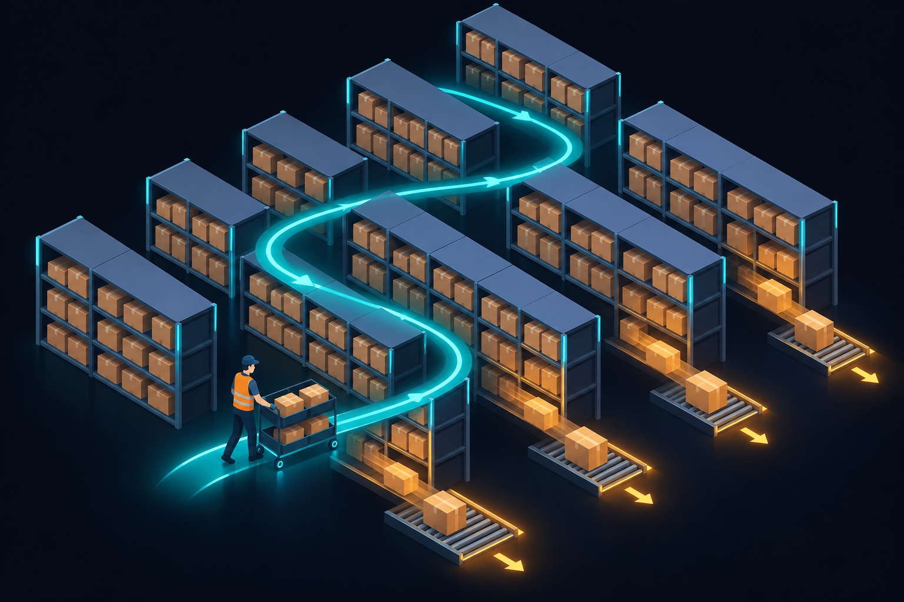
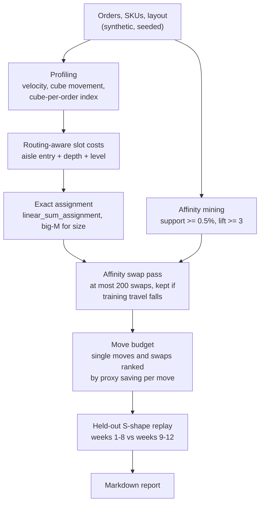

# reslot

[](https://github.com/SlateGitOrg/reslot/actions/workflows/ci.yml)



reslot re-slots a forward pick area as an exact assignment of SKUs to slots, using a slot cost that matches the routing pickers walk (S-shape, where the number of aisles entered dominates travel) instead of distance to the door. Every plan is scored by replaying orders from weeks it was never fitted on, with the training-week number printed beside the held-out one, and a move budget ranks single moves and swaps by the travel they save so a team can re-slot 150 SKUs instead of 1,500. The warehouse, SKUs and orders are synthetic, produced by a seeded generator in the repo.

## The problem

A third-party logistics provider runs each-pick fulfilment for a health-and-beauty e-commerce client from a 10-aisle forward pick area. Slots were assigned as SKUs arrived, so today's fast movers sit in far aisles and on top shelves, and walking is most of pick labour. Re-slotting proposals are usually scored on the same weeks of orders used to design them, and on straight-line distance to the door, which ignores how pickers actually route. The promised savings then fail to show up on the floor, and every move costs labour.

## How it works



The layout is 10 aisles x 2 sides x 24 bays x 4 levels (1,920 slots, 60% S, 30% M, 10% L), aisles 24 m long and 4 m apart, with the depot at the front of aisle 1 and cross-aisles at the front and back. Pickers push carts that batch 8 orders in arrival order.

Under S-shape routing every aisle that holds a pick is walked end to end. If an odd number of aisles is visited, the last one is entered from the front and left from its deepest pick. So a cart that needs one item from each of five aisles walks five aisles, wherever in the aisle the items are. The `aisle` objective prices a slot as the expected cost of keeping its aisle on the route (aisle length plus a cross-aisle term that grows with the aisle's distance from the depot), plus a small depth term and a penalty for floor and top-shelf levels. The `depot` objective is plain rectilinear distance, kept as the comparator.

The assignment cost of SKU `i` in slot `j` is `weekly picks x slot cost`, or a big-M when the SKU's case does not fit the slot. It is solved exactly with `scipy.optimize.linear_sum_assignment`. A bounded affinity pass then tries swaps that put kit pairs in one aisle, and a move budget walks from today's slotting towards the target one ranked step at a time.

## Quick start

Python 3.11 or newer.

```bash
python -m venv .venv && source .venv/bin/activate
pip install -e ".[dev]"

reslot generate --seed 7 --out data          # layout, SKUs, 12 weeks of orders, current slotting
reslot profile --data data --out out         # velocity, cube, cube-per-order index, affinity pairs
reslot plan --objective aisle --moves 150 --data data --out out   # writes out/moves.csv
reslot replay --data data --out out          # held-out replay table
reslot report --data data --out out          # out/report.md
pytest -q
```

`--moves` takes an integer or `unlimited`. `--objective` is `aisle` or `depot`. `--train-weeks` (default 8) sets how many leading weeks the slotting is fitted on; the rest are held out.

## Example output

All numbers come from `reslot generate --seed 7` followed by `reslot replay` and `reslot report` (about 10 seconds each on a laptop). The data has 30,268 orders and 69,594 lines; 20,163 orders fall in weeks 1-8 and 10,105 in weeks 9-12.

Replay: S-shape metres per order for slotting fitted on weeks 1-8. The last column re-scores held-out weeks under largest-gap routing, a policy the plans were not designed for.

| plan | SKUs moved | training m/order | held-out m/order | training vs current | held-out vs current | held-out m/order, largest-gap |
|---|---:|---:|---:|---:|---:|---:|
| current | 0 | 32.56 | 32.85 | - | - | 27.28 |
| full re-slot, depot | 1500 | 15.80 | 16.94 | -51.5% | -48.4% | 14.34 |
| full re-slot, aisle | 1496 | 13.69 | 14.90 | -58.0% | -54.6% | 13.14 |
| aisle, 50 moves | 50 | 28.86 | 29.62 | -11.4% | -9.8% | 24.17 |
| aisle, 150 moves | 147 | 23.94 | 24.86 | -26.5% | -24.3% | 20.76 |
| aisle, 300 moves | 291 | 20.75 | 21.71 | -36.3% | -33.9% | 18.10 |
| aisle, unlimited moves | 1287 | 16.47 | 17.36 | -49.4% | -47.2% | 15.20 |

`full re-slot, aisle` saves 58.0% of travel per order on the weeks it was fitted on (weeks 1-8) but 54.6% on the held-out weeks (9-12): an optimism gap of 3.3 points.

Top 10 moves of the 150-move aisle plan. The saving is the proxy used for ranking (weekly pick lines x drop in slot cost), not measured travel. A swap shows two rows, one per SKU. The full list is in `examples/moves.csv`.

| rank | sku | product | from | to | proxy saving (pick-metres/week) |
|---:|---|---|---|---|---:|
| 1 | SKU1156 | Lumen Bamboo Mascara | A07-R07-3 | A01-L01-3 | 17681.2 |
| 2 | SKU0592 | Sorrel Mint Night Cream | A07-L22-4 | A01-R01-3 | 10146.4 |
| 3 | SKU1371 | Lumen Tea Tree Mascara | A06-R22-2 | A01-L01-2 | 5489.1 |
| 4 | SKU0633 | Oakmoor Bamboo Face Serum | A06-L01-4 | A01-R14-4 | 2300.1 |
| 5 | SKU1330 | Sorrel Charcoal Magnesium Tablets | A07-R09-4 | A01-L03-3 | 1990.1 |
| 6 | SKU0631 | Oakmoor Citrus Toothpaste | A09-L05-1 | A01-R04-3 | 1629.6 |
| 7 | SKU0318 | Oakmoor Tea Tree Shave Foam | A09-L02-1 | A01-L04-2 | 1565.1 |
| 8 | SKU0658 | Sorrel Marine Razor Cartridges | A06-R05-4 | A01-R03-2 | 1494.6 |
| 9 | SKU0981 | Novara Ginger Lip Tint | A04-R08-4 | A01-L02-3 | 1482.3 |
| 10 | SKU1246 | Novara Oat Vitamin C | A10-R20-4 | A01-R05-2 | 1384.5 |

Affinity mining on the training weeks. The generator injects 25 kit pairs; all 25 are mined and no other pair passes the thresholds. The first 10 are shown, the rest are in `examples/report.md`.

25 pairs with support >= 0.5% and lift >= 3 in the training weeks. The affinity pass accepted 0 swaps for the aisle objective and 8 for the depot objective.

| sku a | sku b | support | lift | same aisle in aisle plan |
|---|---|---:|---:|---|
| SKU0010 Sorrel Citrus Mouthwash | SKU0629 Sorrel Citrus Toothpaste | 0.95% | 101.3 | yes |
| SKU0960 Aurel Bamboo Body Lotion | SKU1445 Aurel Bamboo Body Wash | 0.95% | 91.2 | yes |
| SKU0819 Halden Marine Shave Gel | SKU1485 Halden Marine Aftershave Balm | 0.94% | 101.8 | yes |
| SKU0512 Lumen Marine Moisturiser | SKU0600 Lumen Marine Face Wash | 0.94% | 96.3 | yes |
| SKU0289 Oakmoor Peppermint Body Wash | SKU1043 Oakmoor Peppermint Body Lotion | 0.94% | 70.4 | yes |
| SKU0210 Fernhill Bamboo Toothpaste | SKU0255 Fernhill Bamboo Mouthwash | 0.93% | 100.2 | yes |
| SKU1212 Calder Tea Tree Shampoo | SKU1317 Calder Tea Tree Conditioner | 0.92% | 93.8 | yes |
| SKU0835 Veda Argan Face Wash | SKU1184 Veda Argan Moisturiser | 0.89% | 103.2 | yes |
| SKU0220 Oakmoor Ginger Toner | SKU1397 Oakmoor Ginger Cleanser | 0.87% | 108.3 | yes |
| SKU0232 Lumen Peppermint Night Serum | SKU0639 Lumen Peppermint Eye Cream | 0.85% | 69.8 | yes |

## Design decisions

**Aisle-major slot cost instead of distance to the door.** Under S-shape routing a cart's distance is set mostly by which aisles it enters, so the `aisle` cost makes every slot of aisle `k` cheaper than every slot of aisle `k + 1` and lets depth and level break ties inside an aisle. The `depot` objective spreads the fastest 100 SKUs over several aisles (they sit around the depot corner), and the replay shows the price: -48.4% against -54.6% on held-out weeks. The cost is a model, not a fit: its lateral, depth and level weights are fixed defaults in `costs.py`, and a site with different cross-aisle habits would need to recalibrate them.

**Exact assignment of a separable cost, then a replay for everything else.** With cost `picks x slot cost` the problem is a linear assignment, so the optimum is exact and checked against brute force on a 6 x 6 instance. What it cannot see is interaction: two SKUs ordered together share a trip, and whether a SKU forces an aisle visit depends on its neighbours. That is why the plan is scored by simulating carts rather than by the objective value, and why the affinity pass is judged by replayed travel.

**Held-out replay with the gap on display.** Slotting uses weeks 1-8 and is scored on weeks 1-8 and 9-12. The generator makes 40 sun-care SKUs triple in weeks 9-12 only, so the held-out weeks differ from training the way a season turning would. The aisle plan saves 58.0% in training and 54.6% held out. The 3.3-point difference is the optimism a same-weeks score would have hidden. A longer shift in demand would widen it; reslot reports it rather than correcting for it.

**Move budget ranked by proxy, judged by replay.** Steps are single moves into an empty target slot (1 move) or a swap with the target slot's occupant (2 moves), taken best saving per move first. The proxy is linear in picks, but travel is not. The 150-move plan realises 78% of the full re-slot's proxy saving (81,169 of 104,473 pick-metres per week) yet only 24.3 of the 54.6 points of held-out travel saving, about 44%, which is what S-shape predicts: an aisle leaves a cart's route only when the last SKU the cart needs from it has moved. The unlimited plan stops at -47.2% with 355 SKUs (8% of pick lines) short of the target, where the displaced SKU would not fit the slot being vacated or the swap does not pay on its own. Ranking by the proxy is cheap and order-preserving; trusting its size is not, which is why the budget table comes from replay.

**Affinity pass kept small and honest.** At most 200 candidate swaps are tried, strongest pair first, and one is kept only if replayed training travel falls. On this data the `aisle` assignment already puts all 25 kit pairs in aisle 1, because a pair with at least 0.5% support is ordered at least 12 times a week, so both members are fast movers; the pass finds nothing to do there. It accepts 8 swaps under the `depot` objective, where pairs are split across aisles, and those save under 0.5% of training travel. It is a safeguard for cases where pairs are split, not a main source of savings here.

## Testing

```bash
pytest -q
ruff check . && ruff format --check .
```

The suite runs offline in about 35 seconds. It checks the S-shape fixtures by hand (20 m, 64 m and 84 m for the three layouts in the brief), the exact assignment against all 720 permutations, the data invariants (every SKU slotted once, no shared slots, no SKU in a slot that is too small), recovery of the injected kit pairs (25 of 25 with none extra on seed 7; the test asks for at least 23 and at most 2 extra), held-out savings and the optimism gap, move-budget monotonicity, and that the same seed gives byte-identical `moves.csv` and identical replay numbers. The replay's current-slotting travel is also recomputed independently from the order file in a test.

## Project layout

```
src/reslot/
  layout.py     aisles x sides x bays x levels, slot sizes, coordinates, CSV I/O
  generate.py   seeded synthetic SKUs, orders and legacy-biased current slotting
  data.py       Sku, Orders, Dataset containers and CSV read/write
  profile.py    velocity, cube movement, cube-per-order index, affinity mining
  routing.py    S-shape and largest-gap distance, cart batching
  costs.py      slot cost under the aisle and depot objectives
  assign.py     big-M cost matrix and exact linear assignment
  travel.py     order replay and incremental swap scoring
  affinity.py   bounded swap search for co-ordered pairs
  moves.py      greedy move budget (single moves and swaps)
  plan.py       fit a target slotting on training weeks
  replay.py     held-out replay across plans
  report.py     Markdown report
  cli.py        typer commands
tests/          pytest suite
examples/       report.md and moves.csv from the seeded run
```

## License

MIT. See `LICENSE`.
